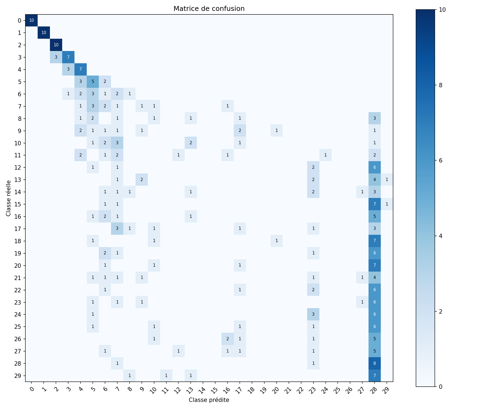

# Naafiri: learning to solve the Rubik's cube

A neural network that estimates how many moves a Rubik's cube is from being solved. The goal is to
use it as a heuristic to guide a solver.

## The cube

`cube.py` is a cube simulator built on the cubie representation: permutation and orientation of the
8 corners and the 12 edges, with the 12 quarter-turn moves. Each state is one-hot encoded into a
244-dimensional vector.

The network is a PyTorch MLP (3 hidden layers of 256 units). It classifies a state into its
distance to the solved cube.

## Two approaches

### `method_1`: supervised, label = scramble length

Scramble a solved cube with *n* random moves and train the network to predict *n*.

This plateaus. A scramble of *n* moves is often closer than *n* to the solved state (moves cancel
out), so the labels get noisier as *n* grows. Beyond about 7 moves, the confusion matrix shows the
network collapsing towards a single class.



### `method_2`: self-bootstrapped targets

Instead of trusting the scramble length, the target for a state is computed from the network itself:

```
target(s) = 0                                    if s is solved
target(s) = 1 + min over neighbours s' of d(s')  otherwise
```

where `d` is the network's current prediction. This is approximate value iteration, the same idea as
DeepCubeA (Agostinelli et al., 2019).

Training is batched on the GPU (MPS) and starts from short scrambles (1 to 6 moves), so the network
first learns the states close to the solution before propagating further.

## Results

Evaluation against an exact BFS oracle (300 random states per depth, `method_2/_bfs_eval.py`):

| Depth | Exact distance predicted |
|---|---|
| 1 | 100 % |
| 2 | 100 % |
| 3 | 100 % |
| 4 | 88.7 % |
| 5 | 69.3 % |

Next steps: train on deeper scrambles, then plug the network into a search (A* / beam search) to
actually solve scrambled cubes.

## Run it

```bash
python -m venv venv && source venv/bin/activate
pip install -r requirement.txt
python method_2/data.py    # generate training states
python method_2/train.py   # train (resumes from method_2/model.pth if it exists)
cd method_2 && python _bfs_eval.py   # evaluate against the BFS oracle
```

## Credits

Built by Foucauld Bellanger with Clément Bonnard ([BLEMENT33](https://github.com/BLEMENT33)) and
[gabi0s](https://github.com/gabi0s). The batched GPU training loop and the BFS evaluation script were
written with the help of an AI coding assistant.
